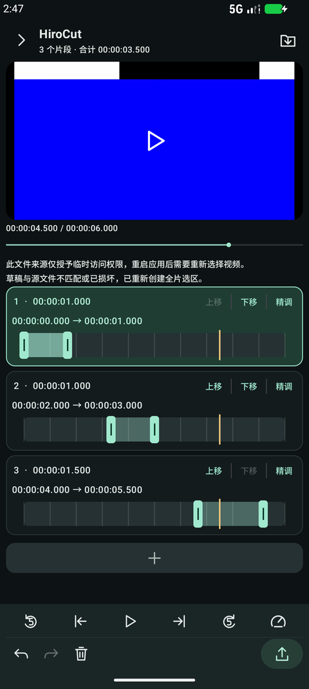
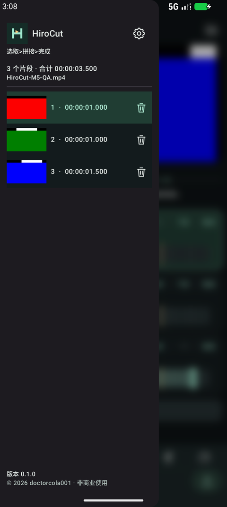
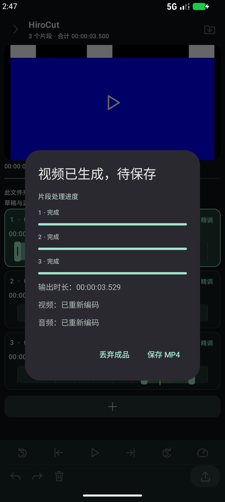

# HiroCut

[简体中文](README.md) | **English**

An offline Android video trimmer and sequential joiner, currently **v0.1.0**. Built with Kotlin, Jetpack Compose, and AndroidX Media3. Requires Android 10 or later.

Select multiple ranges from one video, arrange them in a list, and export a single MP4. Every track uses the complete source timeline; repeated, overlapping, and reverse-order ranges are supported.

## Features

- Video preview, seeking, five-second jumps, preview playback speed, and setting range boundaries from the current frame.
- Multiple ranges, precise time entry, reordering, deletion, undo/redo, and local draft recovery.
- Add a range from the current playhead with the “+” card at the bottom of the track list.
- Fast mode prefers compatible stream copying; precise mode allows frame-based re-encoding.
- Per-clip processing progress, cancellation, output verification, and saving through the system document picker.
- Sidebar thumbnails and clip management, background blur, three color themes, and English/Simplified Chinese UI.
- Fully offline at runtime: no accounts, ads, analytics, or uploads; no `INTERNET` permission.

| Editor | Clip sidebar | Export result |
| --- | --- | --- |
|  |  |  |

## Download

Download the locally built v0.1.0 preview APK and its SHA-256 checksum from [GitHub Releases](https://github.com/doctorcola001/HiroCut/releases/tag/v0.1.0). The current APK uses a debug signing key; long-term production signing is not configured yet.

## Usage

1. Import one local video.
2. Drag the range handles or enter exact times with “Fine tune.” Add more clips with “+”.
3. Arrange the clips, choose fast or precise export, review the ranges, and start processing.
4. Once verification finishes, select “Save MP4” and choose a local destination.

The In boundary includes its frame; the Out boundary excludes its frame. Preview speed does not change the exported video's speed. Keep the app in the foreground while exporting.

## Supported scope

- Android 10 / API 29 or later.
- Verified 8-bit SDR H.264, or verified Main-profile SDR HEVC, subject to device codec support.
- One AAC audio track or no audio. Fast mode additionally requires compatible MP4/H.264 input and validated keyframe/timestamp conditions.
- HDR/10-bit, multiple audio tracks, and unsupported codec configurations are rejected explicitly. There is no silent SDR fallback or export-strategy switch.
- Precise cuts are limited by video-frame and audio-sample quantization, rather than arbitrary millisecond accuracy. Subtitles, attachments, and optional source metadata are not retained.
- One source and sequential joining only; no multi-source composition, transitions, picture-in-picture, or mixing.

Per-clip progress represents input processing. Encoding and muxing run as a stream; a save is reported successful only after generation, verification, and destination writing complete. A verified output can be recovered after a restart; interrupted encoding cannot resume.

The custom-background setting is currently locked and unavailable.

## Build

Requires **JDK 17**, Android SDK Platform 36, and Build Tools 36.0.0. Dependency versions are pinned. The initial build downloads dependencies; the app itself runs offline. Releases use local builds; GitHub Actions is manual-only.

```bash
export JAVA_HOME=/path/to/jdk-17
export ANDROID_HOME=/path/to/android-sdk
./gradlew :app:assembleDebug
```

Alternatively, set `sdk.dir` in a local, untracked `local.properties` file at the project root.

```bash
./gradlew :app:testDebugUnitTest :app:lintDebug
./gradlew :app:assembleDebugAndroidTest
# With a device connected or an emulator running:
./gradlew :app:connectedDebugAndroidTest
```

Outputs are under `app/build/outputs/apk/`. APKs and signing keys are not committed; distribute release attachments separately through GitHub Releases.

## Validation and release

The v0.1 candidate passed emulator checks for editing, media export, safe saving, bilingual UI, and sidebar animation. Earlier candidates received positive Xiaomi 14 and iQOO device feedback. This does not establish compatibility with every device, codec configuration, or large-file scenario.

- [Development and testing](docs/DEVELOPMENT.md) (Chinese)
- [Release and signing](docs/RELEASING.md) (Chinese)
- [Privacy](docs/PRIVACY.md) (Chinese)
- [v0.1.0 changelog](CHANGELOG.md) (Chinese)

## License

Original project code and assets are offered under **PolyForm Noncommercial 1.0.0**, with attribution to `doctorcola001` and contributors. Use, study, modification, and sharing are allowed for the license's permitted purposes. Uses outside that scope require separate authorization; the [full license](LICENSE), including its express organizational provisions, controls.

This is **source-available, noncommercial software**, rather than an OSI-defined open-source license. Publishing the source does not waive copyright. Redistribution must preserve the license and [copyright notice](NOTICE). Independent third-party libraries retain their own licenses; see [third-party notices](THIRD_PARTY_NOTICES.md).

Contributions under the same license are welcome; see [contributing](CONTRIBUTING.md) (Chinese). Contact the GitHub maintainer `doctorcola001` to discuss commercial licensing.
