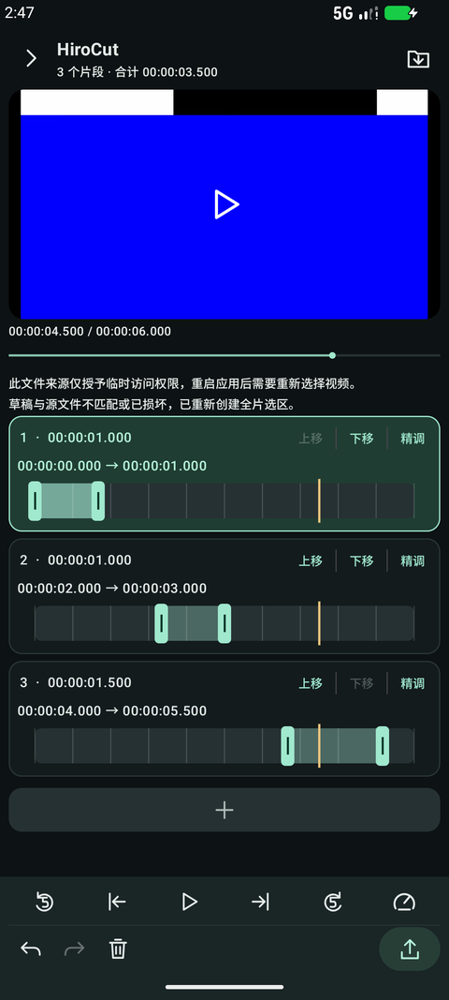
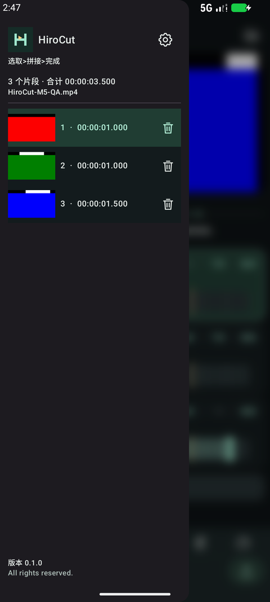
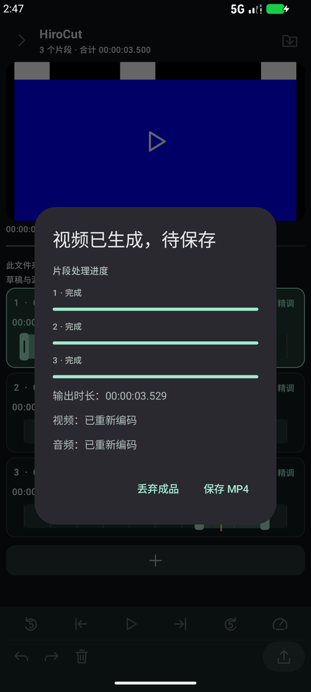

# HiroCut

Android 离线视频裁切与顺序拼接工具，当前版本 **v0.1.0**。使用 Kotlin、Jetpack Compose 和 AndroidX Media3 构建，支持 Android 10 及以上。

从一个视频中选取多个片段，按列表顺序导出为一个 MP4。每条轨道都使用完整源视频坐标，可以重复、重叠或逆序选取。

HiroCut is an offline Android video trimmer and sequential joiner. Select multiple ranges from one source, arrange their order, and export one MP4. Android 10 or later is required. English and Simplified Chinese are included.

## 功能

- 视频预览、定位、前后5秒、预览倍速，以及当前帧设为左右端点。
- 多片段裁切、精调、上移/下移、删除、撤销/重做和本地草稿恢复。
- 点击轨道末尾的“+”，从当前指针位置创建片段。
- 快速模式优先复制兼容编码流；精确模式允许按视频帧重新编码。
- 逐片段处理进度、导出取消、成品校验，以及系统文件选择器保存。
- 侧边栏封面和片段管理、背景模糊、三种颜色主题、中英文切换。
- 完全离线，无账号、广告、分析或上传，无 `INTERNET` 权限。

| 编辑器 | 片段侧栏 | 导出结果 |
| --- | --- | --- |
|  |  |  |

## 使用

1. 导入一个本地视频。
2. 拖动轨道两端手柄，或用“精调”输入起止时间；使用“+”继续添加片段。
3. 调整片段顺序，选择快速或精确导出，确认范围后开始处理。
4. 校验完成后点击“保存 MP4”，选择本地保存位置。

左端点包含对应帧，右端点不包含对应帧。预览倍速不会改变成片速度。导出期间请保持应用在前台。

## 支持范围

- Android 10 / API 29 及以上。
- 已确认配置的8位 SDR H.264，或 Main 配置的 SDR HEVC；实际编码能力取决于设备。
- 单条 AAC 音轨或无音轨。快速模式进一步限于满足关键帧、时间戳等检查的 MP4/H.264 输入。
- HDR/10位、多音轨、不支持的编码配置会明确拒绝；不会静默降级为 SDR 或偷偷切换导出策略。
- 精确裁切受视频帧和音频样本量化限制，不承诺任意毫秒切点。字幕、附件和可选源元数据不保留。
- 当前只支持单源、顺序拼接；不含多素材合成、转场、画中画或混音。

逐片段进度表示各片段输入处理进度；编码与封装流式进行。生成、校验和写入目标文件全部完成后才报告保存成功。进程重启可恢复已校验成品，不支持恢复中断的编码任务。

自定义背景入口目前锁定，暂不可用。

## 构建

需要 **JDK 17**、Android SDK Platform 36 和 Build Tools 36.0.0。依赖版本已锁定，首次构建需要下载依赖；应用运行离线。

```bash
export JAVA_HOME=/path/to/jdk-17
export ANDROID_HOME=/path/to/android-sdk
./gradlew :app:assembleDebug
```

也可以在项目根目录的 `local.properties` 中配置 `sdk.dir`。该文件不提交。

```bash
./gradlew :app:testDebugUnitTest :app:lintDebug
./gradlew :app:assembleDebugAndroidTest
# 连接设备或启动模拟器后：
./gradlew :app:connectedDebugAndroidTest
```

输出位于 `app/build/outputs/apk/`。仓库不存放 APK 或签名密钥，发布附件应单独上传至 GitHub Releases。

## 验证与发布

v0.1 候选代码已完成模拟器编辑、媒体导出、保存保护、双语和侧栏动画回归。此前候选版本获用户在小米14、iQOO上导出及运行正常的反馈；不据此承诺所有设备、编解码配置和大文件场景。

- [开发与测试](docs/DEVELOPMENT.md)
- [发布和签名](docs/RELEASING.md)
- [隐私说明](docs/PRIVACY.md)
- [v0.1.0 更新记录](CHANGELOG.md)

## 许可证

当前尚未指定开源许可证。
